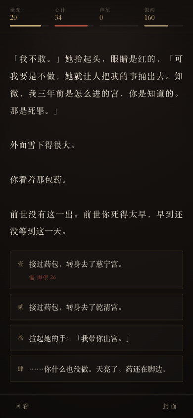

# 话本 · 文字游戏引擎

**零依赖**的网页文字剧情游戏引擎。分支剧情、数值养成、条件锁、多结局、单文件发布 —— 没有后端，没有数据库，没有构建框架，没有 npm 依赖。

《知微》就是用它写的：一部重生宫斗题材的女频文字游戏，29 个节点、4 个结局、672 条通关路径。


| | |
|---|---|
| **数值养成** | 进度条 + 增减飘字，数值名可以用中文 |
| **条件锁** | 选项显示但置灰，带「需 声望 26」提示——让玩家看见自己错过了什么 |
| **多结局** | 结局收集，解锁进度本地留存 |
| **自动存档** | 每步落盘 + 存档码（不依赖浏览器存储，换设备可用） |
| **阅读体验** | 逐字打字机、点屏跳过、已读回看、移动端适配到 360px |
| **单文件发布** | 一个 HTML 发给谁都能打开，42–56 KB |
| **剧本校验** | 穷举所有路径，检查每个结局到底走不走得到 |



---

## 快速开始

需要 **Node 18+** 和 **Python 3**（只用来起本地服务）。

```bash
git clone https://github.com/m505569537/huaben.git && cd huaben

npm run dev              # 起本地服务并打开浏览器（默认 games/zhiwei）
npm run validate         # 校验所有剧本
npm run build            # 打包到 dist/
npm run new -- my-game   # 从模板新建一个游戏
```

---

## 目录结构

```
huaben/
├── engine/              引擎：HTML 外壳 + CSS + JS，一般不用动
├── games/
│   └── zhiwei/          一个游戏 = 一个文件夹
│       └── story.js     剧本数据（你主要改这里）
├── templates/new-game/  新游戏模板
├── tools/
│   ├── validate.mjs     剧本校验器
│   ├── build.mjs        单文件打包器
│   └── new-game.mjs     新建游戏脚手架
├── docs/story-format.md 剧本格式完整说明
├── serve.sh             本地开发服务器
└── .github/workflows/   CI（校验 + 打包）与 Pages 自动部署
```

---

## 加一个新游戏

```bash
npm run new -- my-game "我的游戏名"
./serve.sh my-game
```

然后改 `games/my-game/story.js`：

```js
const STORY = {
  meta: { title: '我的游戏名', subtitle: '一句话勾住人。', tagline: '题材 · 多结局' },

  stats: [
    { key: '好感', init: 0, min: 0, max: 20, color: '#d3b073' },
  ],

  start: 'a1',

  nodes: {
    a1: {
      chapter: '第一章 · 开端',
      text: `正文写在这里。空行分段。`,
      choices: [
        { text: '选项一', next: 'a2', effect: { 好感: 2 } },
        { text: '选项二', next: 'a3', effect: { 好感: -1, flags: ['钥匙'] } },
      ],
    },
    // ……
    z1: {
      text: `最终抉择。`,
      choices: [
        { text: '带着钥匙走。', next: 'end_good',
          require: "has('钥匙') && 好感>=10", hint: '需 钥匙 · 好感 10' },
        { text: '留下来。', next: 'end_bad' },   // ← 必须有无条件兜底
      ],
    },
  },
};
```

完整格式（条件表达式、结局、effect、常见错误）见 **[docs/story-format.md](docs/story-format.md)**。

---

## 校验器在查什么

`npm run validate` 不只是查语法，它会**穷举所有通关路径**：

```
▶ zhiwei  知微
  ✓ 结构  29 个节点 / 4 个结局
  ✓ 路径  672 条通关路径
  ✓ 结局  凤仪天下(40)  长乐无极(92)  雪夜出宫(108)  冷宫(432)
  ✓ 数值  圣宠 4~20  心计 15~35  声望 0~40  银两 130~260
  → 通过
```

它会拦下这些：

- `next` 指向不存在的节点、走不到的孤儿节点、检测到环
- 某节点所有选项都带条件（玩家会卡死）
- 结局条件**永远满足不了**（数值上限太小、或需要的标记和数值互斥）
- 某个选项永远点不到
- effect 里写了没定义的数值名、require 语法错误或引用不存在的名字

> 这个检查不是摆设。开发《知微》时，第一版三个条件结局**全都够不着**，就是它查出来的——全流程最高只能涨到 40，阈值却按 100 拍的。

---

## 打包与发布

```bash
npm run build
# dist/zhiwei.html   单文件，双击能玩，发给谁都能打开
# dist/index.html    游戏列表页
```

### 方式一：Vercel / Netlify / Cloudflare Pages（推荐，私有仓库也能用）

连上仓库即可，配置三项：

| 项 | 值 |
|---|---|
| 构建命令 | `node tools/build.mjs` |
| 输出目录 | `dist` |
| Node 版本 | 20 |

之后每次 push 自动重新发布，拿到 `https://xxx.vercel.app` 就能发给玩家。

### 方式二：GitHub Pages

需要**公开仓库** —— 免费账号的私有仓库不支持 Pages（实测 422）。

仓库转公开后，在 **Settings → Pages → Source** 选 **GitHub Actions**，
再把 `.github/workflows/pages.yml` 里 `on:` 下的 `push:` 两行注释放开即可。

### 方式三：直接发文件

`npm run build` 后把 `dist/<id>.html` 发给别人，双击就能玩——但没有存档（见下）。

---

## ⚠️ 为什么不能直接双击打开

双击打开的是 `file://` 页面。**多数浏览器会拒绝或丢弃 `file://` 页面的 localStorage**（Arc、Safari 尤其严格），于是进度存不住。

| 打开方式 | 存档 |
|---|---|
| 双击 HTML 文件（`file://`） | ❌ 不可靠 |
| `npm run dev`（`http://127.0.0.1`） | ✅ 本地开发用 |
| 部署后（`https://`） | ✅ 真正给玩家用的方式 |

存储被禁时引擎会在封面顶部显示红色提示条，并且「存档码」功能始终可用（不依赖浏览器存储）。

---

## 技术说明

- 纯静态：一个 HTML + 一个 CSS + 一个 JS，无框架、无打包器依赖
- 剧本是普通 JS 对象，用 `vm` 在工具链里沙箱加载，不需要转译
- 条件表达式用 `new Function` 求值，作用域里只有数值和 `has()`
- 存档：`localStorage`，键 `zhiwei.save.v1`（按游戏隔离）；另有 base64 存档码兜底
- 兼容：Chrome / Safari / Edge / 微信内置浏览器，360px 宽度起

---

## License

[MIT](LICENSE)
